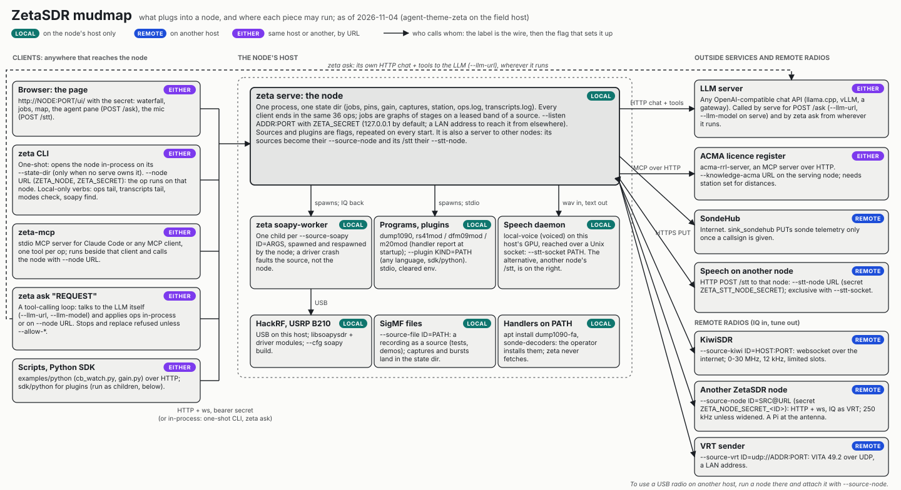

# ZetaSDR

ZetaSDR is an agentic SDR runtime. One node process owns your radios (a SoapySDR device such as a
HackRF or a USRP B210, a KiwiSDR across the internet, a SigMF recording, another node's radio),
keeps a live picture of the spectrum and offers "what is there, what is it, decode it" as a small
set of typed operations (36 of them). The same operations are reached from the `zeta` CLI, an
authenticated HTTP and websocket API, a web page the node serves (waterfall, jobs, map,
transcripts), an MCP server, and an agent that lets a local LLM call them. Every job is a graph of
stages: channelisers, NBFM/WFM/AM/SSB demodulators, decoders (APRS, POCSAG, RDS, ACARS, ADS-B,
radiosondes), measurement and classification, a band watch that identifies what appears, burst
capture, transcription and a mix of every talking channel. It is for an operator who wants the
radio to do the fiddly work, and for an agent that needs operations it can call rather than a GUI
to click.



The figure shows what plugs into a node and which pieces may run on another host
([interactive version](docs/architecture/mudmap.html)).

## Status

Version 0.1.0, for Linux. It is pre-1.0: operations and their fields may still change between
releases, and both ends of a federated link should run the same version. The decoders are tested
against synthesised signals and a few real recordings. Feedback is very welcome; at this stage
contributions come as gists, not pull requests (see [CONTRIBUTING.md](CONTRIBUTING.md)).

## Quick start without a radio

You need Rust (the toolchain is pinned in `rust-toolchain.toml`; `rustup` fetches it) and a C
compiler. A release build takes a few minutes the first time.

```bash
git clone https://github.com/ciphernaut/ZetaSDR
cd ZetaSDR
cargo build --release -p zeta
```

Play a recording as a source. The repository carries a few short captures of a 433.88 MHz key fob
(on-off keyed bursts, recorded on a B210); a file source plays in real time and loops.

```bash
Z=./target/release/zeta
REC=crates/zeta-dsp/tests/data/ook-remote-433882k-1.sigmf-meta
A="--state-dir scratch/state --source-file remote=$REC"
$Z $A source list
$Z $A job start --kind measure --source remote --center-hz 433882000 --bandwidth-hz 50000 --then-tail 1,3000
$Z $A classify --source remote --start-ns 1793747342000000000 --end-ns 1793747343000000000 \
    --center-hz 433882000 --bandwidth-hz 50000
```

Each command opens the node, applies one operation, prints JSON and exits. `job start ...
--then-tail 1,3000` starts a `measure` job, waits for its first event and stops it: a 24 kHz wide
signal 34 dB over the noise, labelled `ook` at about 3190 Bd, with its burst timing. `classify`
runs over a span of the source's ring (a recording's clock starts at its `core:datetime`, so the
span is a second just after 2026-11-03T23:09:01.96Z, in nanoseconds since the UNIX epoch). It adds
catalogue names that fit the band ("ISM Device (433 MHz EU)", a key fob) and lists the decoders it
tried under `tried`; none proved, so it names no protocol.

A decode needs a signal the node has a decoder for. The test fixtures include a synthesised APRS
packet:

```bash
cargo run --release -q -p zeta-dsp --features test-fixtures --example gen_aprs -- scratch/fx
$Z --state-dir scratch/state --source-file aprs=scratch/fx/aprs.sigmf-meta job start \
    --kind aprs_decode --source aprs --center-hz 144800000 --bandwidth-hz 12500 --then-tail 1,5000
```

The frame printed is one AX.25 packet from `VK3ABC`, its FCS checked.

Now run the node and open the page. `zeta serve` keeps jobs running until Ctrl-C and needs a
secret for its API:

```bash
export ZETA_SECRET=change-me-to-a-long-secret
$Z $A --source-file aprs=scratch/fx/aprs.sigmf-meta serve --listen 127.0.0.1:7979
```

Open <http://127.0.0.1:7979/ui/>, paste the secret, and pick a source tab to see its waterfall. In
a second terminal, send operations to the running node; the page shows each one as it is applied:

```bash
export ZETA_NODE=http://127.0.0.1:7979 ZETA_SECRET=change-me-to-a-long-secret
./target/release/zeta job start --kind measure --source remote --center-hz 433882000 --bandwidth-hz 50000
./target/release/zeta job list
```

The measurement appears as a label on the waterfall. Drag across the waterfall to select a band
and ask "What is this?", or stop the job from its row.

## With a radio

Local SDR hardware goes through SoapySDR. It links a C library, so it is behind a compiler flag
rather than a cargo feature:

```bash
sudo apt install libsoapysdr-dev soapysdr-module-hackrf    # or the module for your device
RUSTFLAGS="--cfg soapy" cargo build --release -p zeta
./target/release/zeta soapy find
./target/release/zeta --source-soapy hackrf=driver=hackrf,gain=32 source list
```

The device runs in a worker process the node supervises, so an unplugged cable or a driver crash
faults the source and the node waits for it to come back. With no hardware at all, a KiwiSDR
receiver gives 12 kHz of HF (0-30 MHz) over the network (put a receiver you may use in place of
`kiwisdr.example`):

```bash
./target/release/zeta --source-kiwi kiwi0=kiwisdr.example:8073 job start --kind measure \
  --source kiwi0 --center-hz 7100000 --bandwidth-hz 10000 --then-tail 2,5000
```

Pass the same `--source-*` flags on every command, `serve` included; sources are not persisted.
[Sources](docs/guide.md#sources) in the guide covers the gain, frequency correction and sample
rates, and [Federation](docs/guide.md#federation) a radio on another host, such as a Raspberry Pi
at the antenna.

To let an LLM drive the node, `zeta ask "what sources are there?"` talks to any OpenAI-compatible
endpoint (`--llm-url`, `--llm-model`), and `zeta-mcp` offers every operation as an MCP tool; see
[Transports](docs/guide.md#transports).

## Documentation

[docs/README.md](docs/README.md) lists every document. The main ones:

- [The guide](docs/guide.md): building and testing, a [CLI walkthrough](docs/guide.md#cli-walkthrough),
  [DSP](docs/guide.md#dsp), [speech](docs/guide.md#speech), [sources](docs/guide.md#sources),
  [decoder modes](docs/guide.md#decoder-modes),
  [exploring unknown signals](docs/guide.md#exploring-unknown-signals),
  [external stages](docs/guide.md#external-stages), [transports](docs/guide.md#transports), the
  [web page](docs/guide.md#ui), [wideband](docs/guide.md#wideband) and
  [federation](docs/guide.md#federation).
- [AGENTS.md](AGENTS.md): every operation with its fields, and the field craft an agent (or a
  person) needs to operate well. It is generated from the operation schema.
- [RECIPES.md](RECIPES.md): named job setups (all ACARS channels, ADS-B, UHF CB with
  transcription, a radiosonde watch) as the operations to send.
- [docs/speech.md](docs/speech.md) for transcription, [docs/themes.md](docs/themes.md) for page
  themes.

## Legal

Laws on receiving and decoding radio traffic differ by country, and you are responsible for how
you use a receiver where you are. The node's decoders are for public protocols (APRS, POCSAG,
ADS-B, ACARS, RDS, radiosondes), the ordinary use of a radio. For a signal nobody has named, ZetaSDR stops at measuring it, classifying it,
capturing a few bursts to identify it and reporting who the licence register says transmits there;
recovering and reading the content of someone else's link is not something it does for you; that
is the operator's decision and legal responsibility. The node sends nothing to outside services you have not
configured (the page's map fetches OpenStreetMap tiles while the browser is online); radiosonde
telemetry goes to SondeHub only when you give a callsign.

ZetaSDR is licensed under the Apache License 2.0 ([LICENSE](LICENSE)). It bundles a signal
catalogue, a map library and fonts under their own licences, listed in [NOTICE](NOTICE).

## Feedback and contributions

At this stage ZetaSDR takes feedback and ideas as issues, and code as gists rather than pull
requests. [CONTRIBUTING.md](CONTRIBUTING.md) says how, and what makes a report useful. Security
problems go to [SECURITY.md](SECURITY.md).
